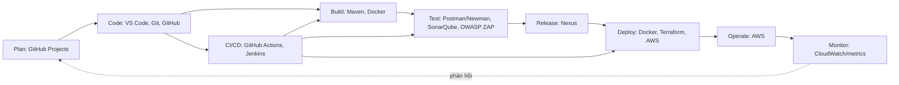

# Lab 2 — DevOps Toolchain & CALMS

## Toolchain hiện có

- VS Code: 1.144.0
- Git: 2.52.0.windows.1
- Node.js: v24.12.0 (tùy chọn)
- Docker: chưa cài/chưa có trong PATH nên chưa build hoặc chạy được container.

## Automation — giải pháp bài 2.1

Dùng `setup-dev-env.ps1` để tạo nhanh cấu trúc ứng dụng Node nhất quán gồm package.json, server.js, Dockerfile và .dockerignore. Người mới clone repository, cài các công cụ theo phiên bản nhóm quy định, chạy script rồi build/run bằng Docker. Đặt script và cấu hình trong Git, thêm kiểm tra vào CI giúp onboarding lặp lại được và giảm hướng dẫn thủ công. Có bản Bash tương đương `setup-dev-env.sh`.

## Lean — ứng dụng Docker

Ứng dụng HTTP trả JSON ở cổng 3000. Dockerfile cố định Node 18 Alpine, bind địa chỉ 0.0.0.0 và chạy bằng user không đặc quyền. Trên máy đã bật Docker Desktop:

```powershell
docker build -t devops-lab2-app .
docker run -d --name lab2-app -p 3000:3000 devops-lab2-app
Invoke-RestMethod http://localhost:3000 | ConvertTo-Json
docker stop lab2-app; docker rm lab2-app
```

JSON mong đợi có `Hello from Docker!`, timestamp, Node version và platform `linux`. Kết quả build/run thật cần bổ sung sau khi Docker sẵn sàng.

## DevOps Toolchain Map



| Giai đoạn | Công cụ | Lab | Mục đích |
|---|---|---|---|
| Plan | GitHub Projects | — | Quản lý task, roadmap |
| Code | Git, GitHub | 1, 5 | Quản lý mã nguồn |
| Code | VS Code | 2 | IDE |
| Build | Maven | 7 | Build Java |
| Build/Deploy | Docker | 2, 7, 8 | Đóng gói ứng dụng |
| Test | Postman/Newman | 6 | Kiểm thử API |
| Test | SonarQube | 6, 7 | Phân tích tĩnh |
| Test | OWASP ZAP | 6 | Kiểm thử bảo mật |
| Release | Nexus | 7 | Quản lý artifact |
| Deploy | Terraform, AWS | 3 | IaC, hạ tầng cloud |
| CI/CD | GitHub Actions | 1 | Tự động hóa pipeline |
| CI/CD | Jenkins | 7 | Pipeline CI/CD |
| Monitor | CloudWatch/metrics | bổ sung | Theo dõi dịch vụ và chỉ số |

## CALMS self-assessment

Điểm dưới đây là tự đánh giá mẫu ở mức khởi điểm; chỉnh theo trải nghiệm nhóm thực tế.

| Trụ cột | Điểm | Nhận xét |
|---|---:|---|
| Culture | 3/5 | Có phối hợp nhóm, chưa có dữ liệu thực tế để chấm cao hơn |
| Automation | 3/5 | Có script và CI/CD ở một số dự án |
| Lean | 3/5 | Bắt đầu chuẩn hóa môi trường với Docker |
| Measurement | 2/5 | Có kết quả build/test, thiếu monitoring đầy đủ |
| Sharing | 3/5 | Có GitHub, tài liệu và code review |
| **Tổng** | **14/25** | Mức khởi điểm |

Ba hành động cải thiện:

1. Chuẩn hóa onboarding bằng script, pin phiên bản công cụ và đo thời gian setup.
2. Bổ sung CI chạy lint/test/build, theo dõi tỷ lệ thành công và thời lượng pipeline.
3. Viết README/runbook, yêu cầu review và chia sẻ bài học sau sự cố.

## Trước khi nộp

Thay thông tin trong `ho_ten_mssv.txt`. Lưu ảnh vào `screenshots/`: versions, script chạy, Docker build, container/curl, toolchain map và CALMS. Docker chưa khả dụng trong môi trường thực hiện hiện tại nên chưa có bằng chứng build/run; không dùng ảnh giả lập.
